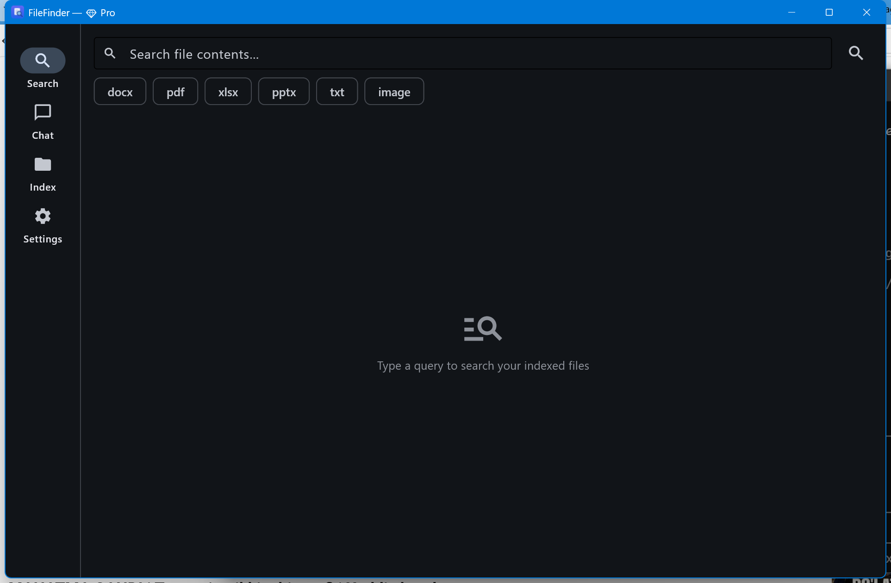
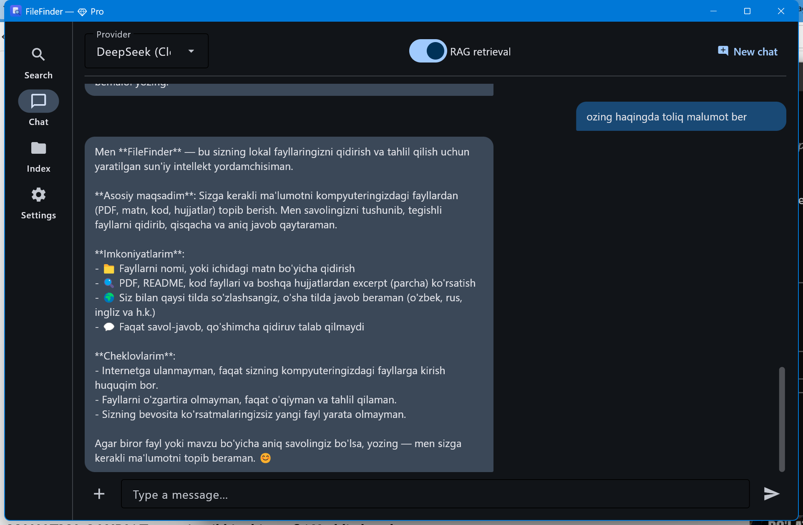
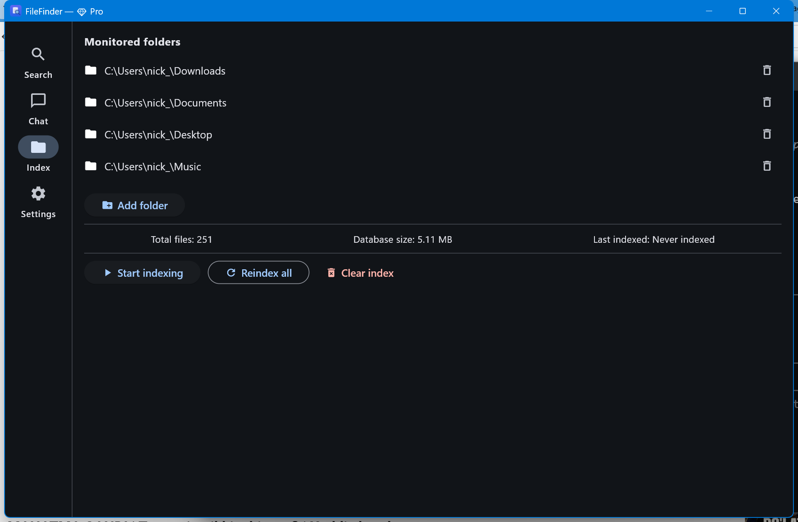
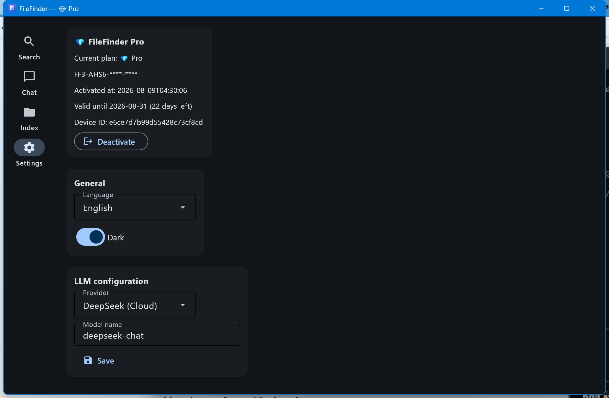

# FileFinder

**AI-powered semantic file search and chat for your local files.**
Find any document by meaning, find any photo by describing what's in it, and chat with your files — all on your own machine.



[](https://github.com/BotirBakhtiyarov/Filefinder/releases)
[](https://github.com/BotirBakhtiyarov/Filefinder/releases)
[](LICENSE)

---

## ✨ Features

- **🔍 Semantic search** — search documents (DOCX, PDF, TXT, XLSX, PPTX, MD) by *meaning*, not just keywords (BGE-m3 embeddings + hybrid keyword score)
- **🖼️ Image content search** — describe what's *in* a photo ("red car", "id card") and find it — CLIP vision-language model, multilingual (English / 中文 / O'zbek)
- **📝 OCR built-in** — text from images and scanned PDFs (Tesseract `chi_sim+eng`), **auto-installed** on first run with poppler
- **💬 Chat with your files** — RAG chat with streaming responses and collapsible thinking blocks; attach files with the `+` button (DeepSeek Cloud built-in, Ollama, or Custom)
- **👁️ Automatic indexing** — standard user folders + all fixed drives indexed automatically on launch; live file watching keeps everything in sync
- **🌐 3 languages** — 中文 / O'zbek / English UI
- **🌙 Dark & Light themes**, system tray with global hotkey (`Alt+Q`)
- **🔄 Auto-update** — new versions are delivered via GitHub Releases
- **🔒 Private by design** — all indexing and embeddings run locally; nothing leaves your machine except the LLM chat API call you choose

## 📸 Screenshots

| Chat with files (RAG) | Index management |
|---|---|
|  |  |

| Settings & Pro license |
|---|
|  |

## ⬇️ Download

Get the latest release from the [**Releases page**](https://github.com/BotirBakhtiyarov/Filefinder/releases):

| Package | When to use |
|---|---|
| `FileFinder-Setup-x.y.z.exe` | Standard installer for most Windows PCs |
| `FileFinder-x.y.z.zip` | PCs with **Smart App Control** enabled (signed-Python setup, no unsigned executables) |
| `FileFinder-vX.Y.Z-windows.zip` | Used by the in-app auto-updater |

**First launch is fully automatic**: embedding models (BGE + CLIP) download themselves, Tesseract OCR and poppler install themselves, your standard folders are indexed in the background. No manual setup.

## 💎 Free vs Pro

| | Free | 💎 Pro (¥19.9/month) |
|---|---|---|
| Semantic file search | ✅ Unlimited | ✅ Unlimited |
| Image content search | ✅ Unlimited | ✅ Unlimited |
| OCR | ✅ Unlimited | ✅ Unlimited |
| File indexing | ✅ Unlimited | ✅ Unlimited |
| AI Chat (DeepSeek Cloud built-in) | 20 queries | ✅ Unlimited |
| RAG chat + file attachments | — | ✅ |
| Export results (CSV/Excel) | — | ✅ |
| Watched folders | 1 | ✅ Up to 20 |

**Activate Pro**: open Settings → upgrade → pay with WeChat Pay or Alipay (QR code in the app), then enter your activation key (`FF3-XXXX-XXXX-XXXX`).

## 🚀 Run from source

```bash
git clone https://github.com/BotirBakhtiyarov/Filefinder.git
cd Filefinder
python -m venv .venv && .venv\Scripts\pip install -r requirements.txt
.venv\Scripts\python -m filefinder.main
```

Run the tests:

```bash
.venv\Scripts\python -m pytest tests/ -q
```

## 🛠 Tech stack

| Area | Technology |
|---|---|
| UI | [Flet](https://flet.dev) (Flutter for Python) |
| Text embeddings | BAAI/bge-m3 (ONNX Runtime, ~2.3 GB, auto-downloaded) |
| Image embeddings | CLIP ViT-B/32 multilingual (ONNX, auto-downloaded) |
| OCR | Tesseract (`chi_sim+eng`) + poppler — auto-installed |
| Vector store | ChromaDB (desktop) / sqlite-vec (Android, planned) |
| LLM | DeepSeek (built-in cloud), Ollama, custom OpenAI-compatible |
| Packaging | flet build + Inno Setup / SAC-safe zip |

## 🔐 Privacy

FileFinder indexes your files **locally**. OCR results, embeddings and the search index never leave your computer. The only outbound calls are: model downloads (HuggingFace), update checks (GitHub), and the chat API you configure (DeepSeek/Ollama/custom).

## 👤 Author

**Botir Bakhtiyarov** — [GitHub](https://github.com/BotirBakhtiyarov) · WeChat: `nick_2620`
