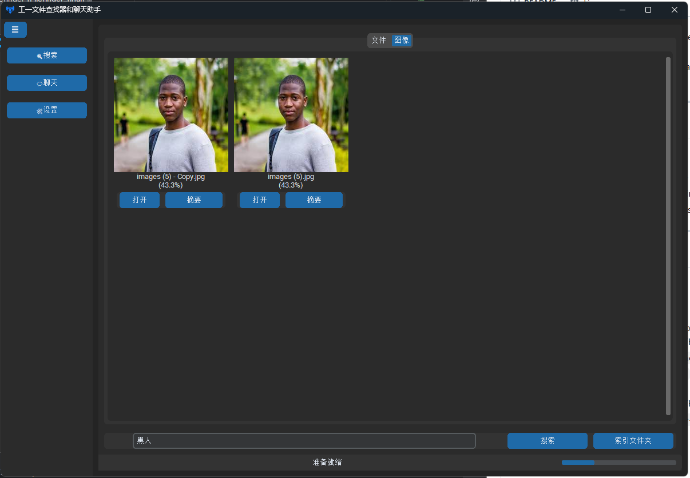
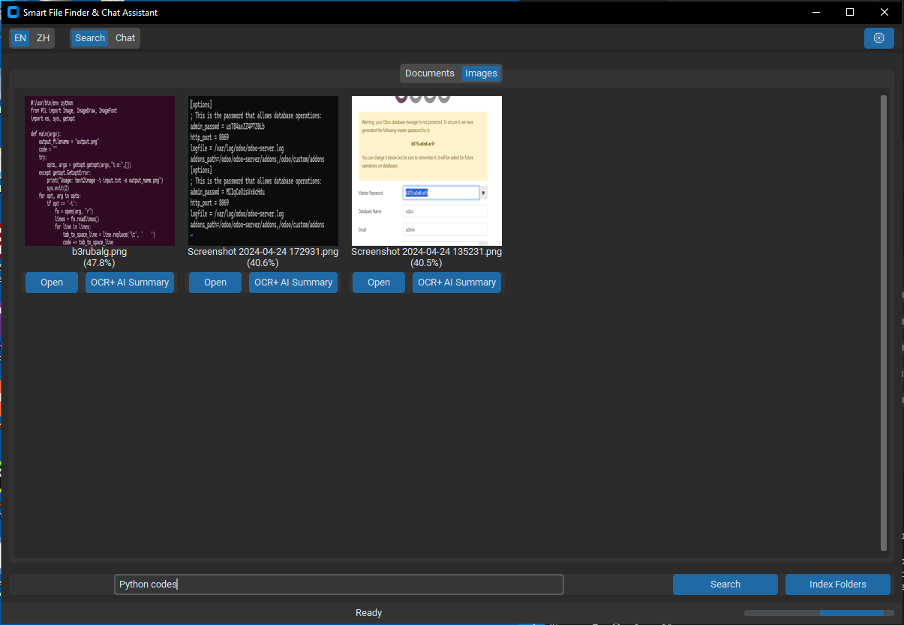

# Filefinder v2

<p align="center">
  <strong>AI-Powered File Intelligence Platform for Chinese Documents</strong>
</p>

<p align="center">
  <a href="https://github.com/BotirBakhtiyarov/Filefinder/stargazers">
    
  </a>
  <a href="https://github.com/BotirBakhtiyarov/Filefinder/network/members">
    
  </a>
  <a href="https://github.com/BotirBakhtiyarov/Filefinder/blob/main/LICENSE">
    
  </a>
  
  
  
</p>

<p align="center">
  Semantic search, OCR, and AI chat for your documents and images — optimized for Chinese content.
</p>

---

## Table of Contents

- [Overview](#overview)
- [Key Features](#key-features)
- [Screenshots](#screenshots)
- [Installation](#installation)
- [Usage](#usage)
- [Tech Stack](#tech-stack)
- [Project Structure](#project-structure)
- [Contributing](#contributing)
- [License](#license)
- [Contact](#contact)

---

## Overview

**Filefinder v2** is a powerful desktop application that transforms how you manage and interact with files. Built for professionals, researchers, and teams working with large document collections in Chinese environments, it combines semantic search, OCR, and retrieval-augmented generation (RAG) into a single intelligent assistant.

Whether you need to find a specific document, extract text from images, or have a conversation about your files, Filefinder makes it feel effortless.

---

## Key Features

- **Semantic File Search** — Find documents (DOCX, PDF, TXT) and images (JPG, PNG) using natural language queries in Chinese.
- **AI-Driven Insights** — Generate embeddings for text and images with models optimized for Chinese content, powered by SentenceTransformers and ChineseCLIP.
- **OCR Excellence** — Extract and summarize text from images and PDFs using Tesseract OCR with Chinese character support (`chi_sim`).
- **Smart Chat Assistant** — Engage in contextual conversations or summarize files with a Chinese-focused AI, supporting both Normal and RAG modes.
- **Chinese Interface** — Fully localized UI with intuitive navigation, designed for native Chinese speakers.
- **Dark/Light Mode** — Toggle themes for comfortable use in any lighting.
- **System Tray Integration** — Minimize to tray and restore with a global `Alt+Q` hotkey.
- **Continuous Indexing** — Automatically update file indexes for monitored directories.

---

## Screenshots

> Screenshots will be updated with v2's Chinese interface.

- **Search Tab**: 
- **Chat Assistant**: 
- **OCR Summary**: *(to be added)*

---

## Installation

### Option 1: Windows Installer (Recommended)

Download `FileFinderSetup.exe` from the [Releases](https://github.com/BotirBakhtiyarov/Filefinder/releases) page and run the installer.

### Option 2: Run from Source

**Requirements:**
- Python 3.10+
- Tesseract OCR with Chinese language pack (`chi_sim`)

**Steps:**

```bash
# Clone the repository
git clone https://github.com/BotirBakhtiyarov/Filefinder.git
cd Filefinder

# Create a virtual environment
python -m venv venv
source venv/bin/activate  # On Windows: venv\Scripts\activate

# Install dependencies
pip install -r requirements.txt

# Run the application
python main.py
```

---

## Usage

1. **Launch** Filefinder from the Start Menu or source.
2. **Select directories** to monitor and index.
3. **Search** your files using natural language in Chinese.
4. **Chat** with your documents in Normal or RAG mode.
5. Press `Alt+Q` anywhere to bring the app to the foreground.

---

## Tech Stack

| Layer | Technology |
|-------|------------|
| Desktop GUI | CustomTkinter |
| Backend API | Flask |
| Embeddings | ChineseCLIP, SentenceTransformers (paraphrase-multilingual-MiniLM-L12-v2) |
| OCR | Tesseract OCR |
| AI Models | Compatible with DeepSeek / OpenAI-style APIs |
| Packaging | PyInstaller / Windows Installer |

---

## Project Structure

```
Filefinder/
├── app/                 # Application modules
├── assets/              # Images and static resources
├── screenshots/         # UI screenshots
├── main.py              # Application entry point
├── requirements.txt     # Python dependencies
└── README.md
```

---

## Contributing

Contributions are welcome! Please open an issue or submit a pull request with your improvements.

1. Fork the repository
2. Create a feature branch (`git checkout -b feature/amazing-feature`)
3. Commit your changes (`git commit -m 'Add amazing feature'`)
4. Push to the branch (`git push origin feature/amazing-feature`)
5. Open a Pull Request

---

## License

This project is licensed under the MIT License — see the [LICENSE](LICENSE) file for details.

---

## Contact

- **Author:** Botir Bakhtiyarov
- **Email:** hello@bbotir.xyz
- **Website:** https://bbotir.xyz
- **Telegram:** [@opensource_uz](https://t.me/opensource_uz)
